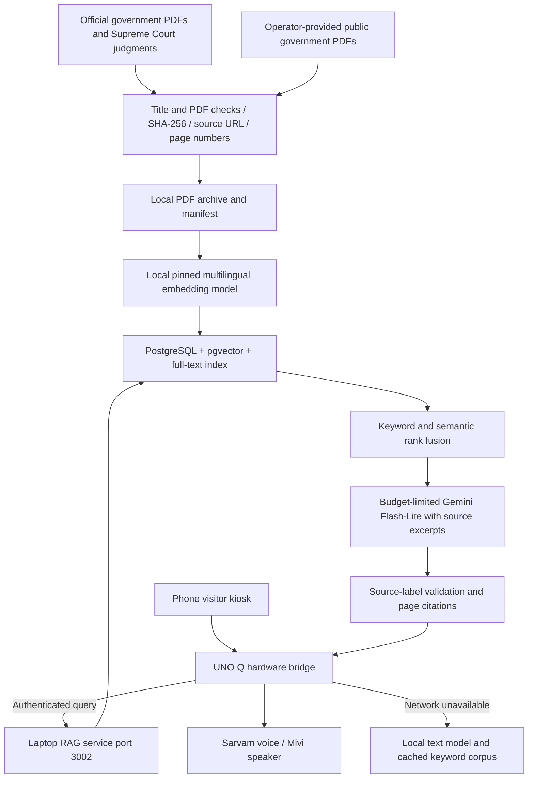

# Dharmaraksha RAG — PostgreSQL and pgvector

The laptop uses **PGlite**, an embedded PostgreSQL runtime with the real pgvector extension. Docker is not required. It is a single-process prototype database, not a multi-client PostgreSQL server. `legal_documents`, `legal_chunks`, and `legal_ingestions` store relational metadata, page text, vectors and ingestion records. Existing private case/Firebase records are preserved and have not been migrated.

## Architecture

## Start

From `nexus-mcp` on the laptop, after `npm ci`:

1. `npm run rag:build` downloads/verifies the configured official references and updates the offline keyword index. Failures preserve prior indexed versions.
2. `npm run rag:index` compiles the server and populates PostgreSQL/pgvector with local embeddings. The first run downloads the model. Subsequent runs skip documents whose checksum and embedding version match. Stop `rag:serve` before indexing into PGlite.
3. `npm run rag:serve` starts the authenticated RAG service. Keep this running while using the kiosk.
4. Set the laptop application's `RAG_SERVER_URL=http://127.0.0.1:3002`; start the dashboard backend normally. Set UNO Q's URL to the laptop's LAN address on port 3002 and use the **same private `RAG_SERVER_TOKEN`**. Never put that token in browser code.

The private laptop `.env` contains a generated token. Do not publish it. `GET /health` exposes corpus counts; `/query` and `/search` require `Authorization: Bearer <token>`. The machine must remain on the same LAN. Restrict any firewall rule to the trusted local subnet.

## Add your documents

See `nexus-mcp/rag/inbox/README.md`. Add public reference PDFs and provenance metadata to the operator-maintained catalog; then rebuild and index. Do not put visitor case documents in this shared corpus. Text-free scanned PDFs require reviewed OCR first. Title and checksum checks do not independently establish that an operator-provided PDF is authentic. Verify its bytes/content against the linked government publication before registration.

## Files

- `nexus-mcp/rag/sources.json`: official-source catalog, kind, date and jurisdiction metadata.
- `nexus-mcp/data/legal/pdfs/`: retained public PDFs; `manifest.json` records actual successful downloads/checksums/failures.
- `nexus-mcp/data/legal-postgres/`: persistent PostgreSQL database. Back it up when the RAG process is stopped.
- `nexus-mcp/data/models/`: downloaded model cache; retain it for offline retrieval.
- `nexus-mcp/rag/schema.sql`: pgvector, HNSW and full-text indexes plus relational tables.
- `nexus-mcp/scripts/index-postgres.ts`: per-document atomic indexing.
- `nexus-mcp/scripts/serve-rag.ts`: authenticated laptop service.

## Retrieval and cost

Embeddings run locally using a pinned q8 revision of multilingual MiniLM, 384 dimensions; they use no Gemini/Sarvam credits. Keyword results preserve exact legal terms; semantic search helps paraphrases and cross-language queries. Reciprocal-rank fusion combines them and avoids repeated pages. Results carry source URL, PDF page, checksum, download time, document type and known issue date. This does not establish current validity, commencement or whether a judgment was later distinguished/overruled.

Gemini is asked to use only retrieved law passages, cite supplied source labels, ask for missing incident date/jurisdiction, and avoid inventing authorities. Missing/invalid citation labels return source excerpts instead of presenting the draft as verified. Label checking does not prove that every claim follows from its cited text. A local text-model fallback is explicitly offline and must not be treated as verified legal advice. No vector similarity score is displayed as legal confidence.

The existing daily/total budget ledger still governs Gemini and Sarvam. Initial public downloads and local indexing are free of provider usage charges. Coverage is a selected, dated corpus; it is not all Indian law or a complete case-law database.

## Standalone PostgreSQL later

`deploy/rag/compose.yaml` supplies PostgreSQL 17 + pgvector, bound to laptop loopback port 5433 with a named persistent volume. When Docker is available, create its private `.env` from the example with a strong password, run `docker compose up -d`, and set `RAG_DATABASE_URL` to the corresponding PostgreSQL connection string in the backend `.env`. Re-run `rag:index`. The same SQL schema and retrieval queries are used. Do not remove the existing database volume or case data during migration.

Primary technical references: [PGlite](https://pglite.dev/docs/about), [pgvector](https://github.com/pgvector/pgvector), [embedding model](https://huggingface.co/Xenova/paraphrase-multilingual-MiniLM-L12-v2).

## Verified installation

Installed corpus: 16 documents, 3,471 passages, including the Supreme Court's Satender Kumar Antil judgment of 11 July 2022. Four configured sources could not be downloaded (CPC, two commencement notices and the Aadhaar judgment); they are not silently represented as covered. Catalog sources are selected rather than exhaustive.

19 backend tests pass, including real pgvector SQL, transaction rollback, persistence and provider-metadata handling. All seven retrieval examples in `rag/evaluation.json` find the expected document among the returned results across English/Hindi/Kannada/Tamil; this is a small regression set, not a comprehensive legal-accuracy benchmark. An unrelated cooking search returns zero passages, and unauthenticated access returns HTTP 401. `npm run rag:evaluate` uses no paid AI calls. The dashboard build and lint pass.

Laptop endpoints: dashboard `http://localhost:3001/dashboard/`, RAG health `http://localhost:3002/health`. UNO Q reaches the laptop at `10.16.214.64:3002`; the visitor kiosk remains `http://10.16.214.172:3001/kiosk/`. Both laptop processes are currently running but have not been installed as Windows auto-start services; restart them after reboot. Database ownership is protected by a process lock.

## Final health check — 14 November 2026

Laptop RAG and dashboard API both return HTTP 200 with 16 documents and 3,471 passages. UNO Q at its last known address did not respond during the final check; its earlier end-to-end cited-answer test succeeded. Reconnect/power the board and confirm its IP before using the phone kiosk. The laptop launcher is `nexus-mcp/start-rag.ps1`; do not launch a second instance while port 3002 is already running.
