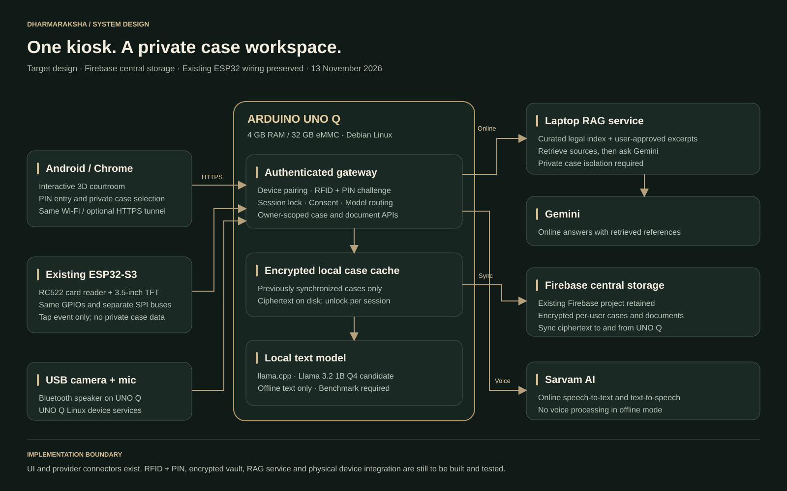
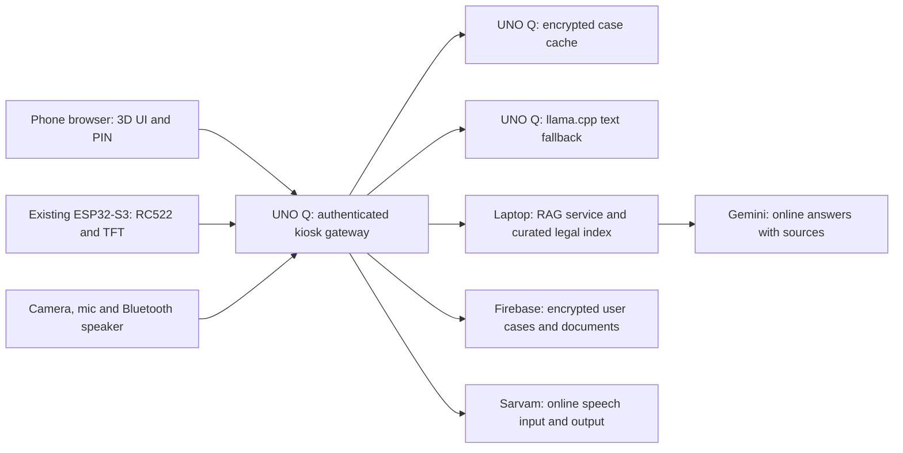

# Dharmaraksha kiosk architecture

Updated 13 November 2026. **Target architecture, not a claim that hardware authentication or encrypted storage is already deployed.** The central store remains the existing Firebase project. The laptop serves RAG; UNO Q serves the phone and local fallback. The ESP32 remains the existing RFID/display peripheral.

Confirmed device setup: **Android phone with Chrome; phone, ESP32 and UNO Q on the same Wi-Fi; USB camera and USB microphone connected to UNO Q; Bluetooth speaker paired with UNO Q.** The phone is the screen/controller. The kiosk's Linux device service must capture the USB devices and play speech through the selected Bluetooth audio sink. Browser `getUserMedia` and browser audio currently use the phone's devices; they do not control UNO Q peripherals remotely.





## What exists now

| Component | Current state |
| --- | --- |
| 3D courtroom, agent profiles, clean view, shared UI theme | Implemented; browser-tested on desktop and mobile layouts |
| Criminal Agent deep link, hover animation and click introduction | Implemented; Sarvam TTS used when configured, labelled browser voice demo otherwise |
| Photo capture, review, retake and explicit Use photo | Implemented with browser camera; not UNO Q USB capture |
| Assistant, document parsing and case workspace | Implemented; existing case data preserved |
| Gemini assistant | Adapter exists; existing key failed validation, so a valid server-side key is needed |
| Sarvam | Server-side TTS adapter and courtroom playback implemented; API key and live test needed. Legacy voice page still uses browser speech; Sarvam STT is not implemented |
| Laptop RAG | Configurable HTTP connector implemented; actual RAG server, corpus and retrieval evaluation are not implemented |
| Local fallback | OpenAI-compatible llama.cpp connector implemented and mock-tested; model/runtime not installed or benchmarked on UNO Q |
| Firebase central storage | Existing integration retained; private encrypted user-vault schema, rules and migration are not implemented |
| RFID + PIN, recovery, idle lock, private case resume | Agreed design below; not implemented. Demo card is explicitly labelled |
| Hardware | Exact pin/config templates saved; no firmware compilation, flashing or physical test performed |

## User journey

1. Pair the phone with this kiosk over authenticated HTTPS. A tunnel is optional for remote access; LAN access must continue when the internet is down. An internet-dependent tunnel alone cannot provide offline access.
2. Tap the existing RFID card. The reader sends a device-authenticated event. The phone shows PIN entry; no case titles, documents or conversation history appear yet.
3. Verify a PIN of at least six digits with persistent attempt limits and unlock the user's vault. A copied UID must never bypass the PIN. Device pairing and a short-lived challenge bind the tap to the correct phone.
4. List only the unlocked user's cases. Select a case to restore its conversation and documents. On a first visit or uncached case while offline, explain that the case is unavailable until synchronization.
5. Capture a document, review it, retake if needed, then explicitly choose Use photo. The hardware mode captures from UNO Q; the current browser prototype captures from the phone/browser camera.
6. Online: send approved excerpts to the laptop RAG service, receive Gemini answers with source references, and optionally use Sarvam voice. Offline: text and previously cached cases only. No voice, OCR or fresh legal research is promised offline.
7. On inactivity, lock or logout: stop capture/audio, clear decrypted memory and screen contents, revoke the session and return to the welcome screen. Sync ciphertext changes when connectivity returns.

## Firebase and encryption boundary

Use the existing Firebase project with a **new, versioned private-vault namespace**. Keep current investigation records intact until an explicit migration and rollback plan is tested. Firebase Admin SDK bypasses client security rules, so server ownership checks are required on every route as well as Firebase rules for any direct client access.

Proposed logical records: `users/{uid}/cases/{caseId}` for encrypted metadata/conversations, and per-user Cloud Storage objects for encrypted document blobs. Small ciphertext envelopes include schema version, key ID, unique nonce, ciphertext and authentication tag; associated data binds the user ID, case ID and version. Generate random data-encryption keys, use authenticated encryption, and never reuse a nonce with the same key.

Store encrypted envelopes in Firebase and in a bounded local SQLite/object cache on UNO Q. Keep decrypted content only in the authorized user session. A short PIN alone is vulnerable to offline guessing: key wrapping needs a benchmarked memory-hard KDF plus an independent device-held secret, persistent rate limits and a separately protected recovery method. Do not store plaintext keys next to the Firebase ciphertext. Key recovery and device replacement must be tested before storing real private documents.

**Privacy wording:** encryption at rest is the target for stored documents. The prototype user has permitted selected plaintext to reach Gemini, Sarvam and the laptop RAG service. This processing path must not be advertised as end-to-end encrypted from those providers. If strict end-to-end encryption against the kiosk operator is later required, decrypt in the user's client and redesign the cloud processing boundary.

Case isolation must also apply to WebSocket events, search indexes, logs, temporary files, provider requests and offline caches. Current legacy dashboard endpoints are an operator prototype, not a safe public multi-user gateway. Do not expose the existing admin/API surface through a public tunnel as the private kiosk service.

## Online and offline routing

The assistant connector tries the configured laptop RAG service first. Without a RAG URL, it uses the existing direct Gemini route. If that online request fails, it attempts `LOCAL_LLM_URL`; responses are labelled as limited offline drafts. Subsequent requests retry the online route, so recovery is automatic at request boundaries. Configured RAG failures do not silently switch to uncited direct Gemini answers.

Current connector timeouts are 15 seconds for RAG, 30 seconds for direct Gemini and 90 seconds for local inference. These are prototype bounds, not measured hardware latency. Deployment needs health checks, bounded retries, cancellation, a circuit breaker and explicit mode status. Do not rely only on the browser's online flag.

Start hardware evaluation with **Llama 3.2 1B Instruct, Q4_K_M, via llama.cpp CPU**, context 2048, one request at a time and at most 256 output tokens. Its role is short text assistance using already-unlocked cached context, not authoritative legal conclusions. Reduce context to 1024 if memory/latency requires it. Language quality must be evaluated separately for English, Hindi, Kannada and Tamil; UI language support does not prove model proficiency.

UNO Q has a Linux application processor and a separate microcontroller; the 4 GB / 32 GB board is the intended host, not an Uno R3. Arduino's practical guide describes approximately 600–700 MB model files and roughly 1 GB RAM for a quantized 1B model at short context. That leaves room to investigate this configuration, but does not prove acceptable latency with camera, services and cache running. [Arduino UNO Q documentation](https://docs.arduino.cc/hardware/uno-q), [official local LLM guide](https://blog.arduino.cc/2026/06/18/running-local-llms-on-the-arduino-uno-q-board-a-practical-guide/).

Example **after** installing a compatible llama.cpp build and accepting the model's license:

```sh
llama-server -m /opt/dharmaraksha/models/llama-3.2-1b-instruct-q4_k_m.gguf -c 2048 --parallel 1 --threads 3 --host 127.0.0.1 --port 8080
```

Set `LOCAL_LLM_URL=http://127.0.0.1:8080` in the server environment. The example model path is not downloaded by this project. Bind the inference server to loopback and call it through the authenticated kiosk gateway. [llama.cpp server reference](https://github.com/ggml-org/llama.cpp/blob/master/tools/server/README.md).

## Provider contracts and configuration

Secrets stay in the backend environment, never Vite variables or firmware committed to Git. See `nexus-mcp/.env.example` for `SARVAM_API_KEY`, `SARVAM_TTS_MODEL`, `SARVAM_SPEAKER`, `LOCAL_LLM_URL`, `LOCAL_LLM_MODEL`, `LOCAL_LLM_API_KEY`, `RAG_SERVER_URL` and `RAG_SERVER_TOKEN`.

`POST /api/voice/speak` accepts `{ "text": "...", "language": "en-IN" }`, limits text to 2,500 characters, and returns non-cacheable WAV audio. The adapter calls Sarvam with the current `language_code` field. `GET /api/voice/status` exposes configuration presence only, not credentials or verified provider health. [Sarvam TTS API](https://docs.sarvam.ai/api-reference/text-to-speech/convert).

The proposed laptop contract is `POST {RAG_SERVER_URL}/query`, authenticated with `RAG_SERVER_TOKEN` when configured. Request: `message`, `language`, optional `context`, and normalized Gemini-style `history` entries (`role: user/model`, `parts: [{text}]`). Response: `{ "reply": "...", "sources": [{ "title": "...", "url": "https://..." }] }`. Retrieval must enforce case ownership and treat uploaded text as evidence, not instructions. The connector alone does not implement RAG or establish source correctness.

## Remaining hardware/product decisions

- Exact USB camera/microphone models, powered USB hub requirements, and the Bluetooth speaker's Linux audio profile. Verify camera capture, microphone levels and speaker output on the board.
- Recovery process when the user loses the card, PIN, phone or kiosk; document retention and user deletion policy.
- Existing Firebase service choices and rules, paired-device enrollment, the laptop RAG corpus and its update policy.
- Measured RAM, temperature, latency, power-loss recovery and concurrent-service behavior on the physical UNO Q.

Hardware wiring handoff: [ESP32 reader](../hardware/esp32-reader/README.md). Build readiness must be assessed against the implementation table above; no hardware or encryption guarantees are implied by this diagram.
